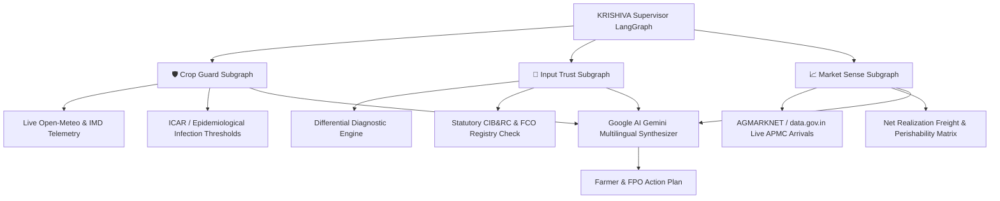

# KRISHIVA AI — Farm-to-Market Agricultural Intelligence Platform

> **Core Philosophy:** Protect the Crop. Trust the Input. Sell Smarter.

**KRISHIVA AI** is an evidence-led agricultural decision intelligence platform designed for Indian farmers, Farmer Producer Organizations (FPOs), agronomists, and agricultural enterprises. It bridges the gap between field pathology, regulatory compliance, and market economics through a LangGraph multi-agent architecture and Google Gemini reasoning.

---

## 🌟 The Three Core Intelligence Systems



### 1. Crop Guard (Crop & Disease Intelligence)
- Real-time microclimatic disease favorability indices (temperature, relative humidity, leaf wetness, rainfall).
- Epidemiological risk assessment for Early Blight (*Alternaria solani*), Late Blight (*Phytophthora infestans*), and Whitefly vectors.
- Transparent rule & calibrated probabilistic outputs with clear uncertainty markers.

### 2. Market Sense (Market Discovery & Net Realization Optimization)
- Ingests official AGMARKNET and e-NAM mandi modal prices and arrivals.
- Computes quantity-aware net realization using the formula:
  $$\text{Net Realization} = \text{Gross Revenue} - (\text{Freight} + \text{Handling} + \text{Mandi Fees} + \text{Transit Quality Loss})$$
- Prevents misleading recommendations based solely on distant high modal prices.

### 3. Input Trust (Statutory Regulatory Input Verification)
- **Differential Diagnosis First:** Prevents false single-cause diagnoses (e.g. distinguishing nitrogen deficiency from iron chlorosis or waterlogging).
- **Statutory CIB&RC & FCO Compliance:** Only recommends pesticides with verified registration numbers, approved crop-target usages, exact label dosages, and Pre-Harvest Intervals (PHI).

---

## 🏗️ Repository Architecture

```
fieldnexus-sentinel/
├── backend/
│   ├── api/v1/routes.py            # FastAPI endpoints
│   ├── config/settings.py          # Pydantic Settings
│   ├── database/models.py          # SQLAlchemy PostgreSQL/SQLite models
│   ├── governance/                 # Data provenance & audit registry
│   ├── integrations/               # Open-Meteo, AGMARKNET, Google AI
│   ├── intelligence/               # Crop Guard, Market Sense, Input Trust
│   │   └── orchestrator/           # LangGraph supervisor workflow
│   ├── knowledge/                  # CIB&RC and FCO regulatory standards
│   ├── ml/training/                # Scikit-learn temporal training & model cards
│   └── schemas/api_contracts.py    # Typed Pydantic request/response schemas
├── frontend/                       # React 18 + TypeScript + Vite UI
├── data/                           # Verified raw, reference & interim datasets
├── models/                         # Trained model artifacts & evaluation cards
├── tests/unit/                     # Automated Pytest suite (10/10 verified)
└── docs/                           # Architecture, audit, and system documentation
```

---

## 🚀 Quickstart & Local Setup

### 1. Prerequisites
- Python 3.11+
- Node.js 18+ and npm

### 2. Backend Setup
```bash
# Clone the repository
git clone https://github.com/NikhilRaman12/fieldnexus-sentinel.git
cd fieldnexus-sentinel

# Configure environment
cp .env.example .env

# Run database migrations / init
python -c "from backend.database.session import init_db; init_db()"

# Run all automated tests (10/10 passing)
pytest tests/unit/test_krishiva_platform.py -v

# Start FastAPI Server
uvicorn backend.api.v1.routes:app --host 0.0.0.0 --port 8000 --reload
```
API Documentation will be live at `http://localhost:8000/docs`.

### 3. Frontend Setup
```bash
cd frontend
npm install
npm run build
npm run dev
```
The KRISHIVA UI will be accessible at `http://localhost:3000`.

---

## 🔒 Security & Data Provenance
- Tracked secrets removed from Git index; active `.gitignore` enforcement.
- Strict data provenance identifiers (`PROV-AGMARKNET-001`, `PROV-WEATHER-003`, `PROV-CIBRC-004`).
- All recommendations carry clear regulatory citations and expert human escalation boundaries.
