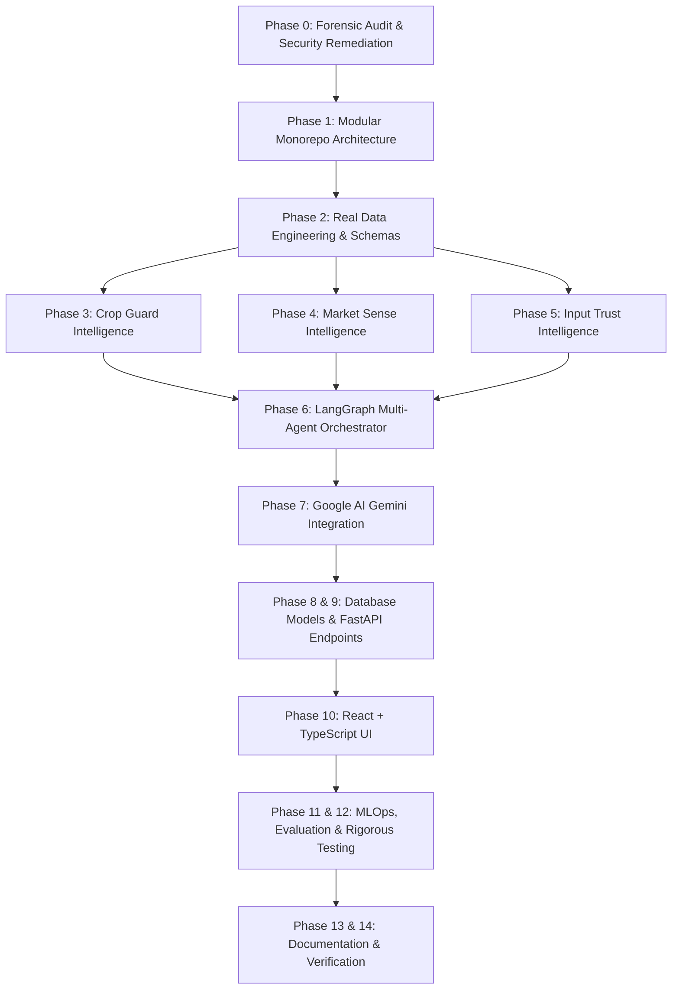

# Repository Forensic Audit Report: FieldNexus Sentinel to KRISHIVA AI

**Date:** 2026-11-13  
**Auditing Team:** Founding Engineering Team (AI/ML, Data Science, Pathology, Market Intelligence, Agentic AI, Cloud Platform)  
**Repository:** `NikhilRaman12/fieldnexus-sentinel`  
**Target Architecture:** KRISHIVA AI — Scalable Farm-to-Market Intelligence Platform

---

## 1. Executive Summary

A comprehensive forensic audit of the `fieldnexus-sentinel` repository was conducted to inspect all source files, models, datasets, dependencies, security vulnerabilities, and architectural patterns.

The existing codebase was a prototype developed for general tabular data exploration, automated random-forest training, and a partial reinforcement learning / game-theoretic framework for agricultural decision simulation (`kaggriculture`). While containing reusable utility concepts and baseline scikit-learn models, the repository suffered from severe architectural, data-integrity, and security deficits:
1. **Critical Security Leak:** A `.env` file containing active API keys (OpenAI, Weather, Sentinel, News, Geolocation) was tracked directly in Git history.
2. **Fabricated Intelligence & Target Generation:** In `src/agents/model_agent.py`, missing targets were synthetically created via median thresholding (`target = 1 if value > median else 0`), violating the core mandate against fake intelligence and ungrounded predictions.
3. **Data Leakage & Inappropriate Splitting:** Models utilized non-temporal, random `train_test_split` on longitudinal climate and agricultural data spanning multiple decades, causing severe temporal look-ahead leakage.
4. **Dataset Misalignment:** Raw datasets consisted of unindexed global FAO/World Bank aggregations (e.g., Albania 1990, Afghanistan 1961, 1849 Cote D'Ivoire temperatures) alongside synthetic CSVs (`agriculture.csv`, `sustainability.csv`, `supply_chain.csv`), lacking verifiable Indian farm/mandi coordinates, timestamps, and realistic market transaction structures.
5. **Architectural Gaps:** The platform lacked real API ingestion adapters (AGMARKNET/data.gov.in, Open-Meteo/IMD, Earth Engine), lacked regulatory pesticide/fertilizer verification registries (CIB&RC, FCO), lacked LangGraph-based multi-agent orchestration with typed states, and lacked an enterprise-grade UI.

---

## 2. Security Forensic & Remediation Action

### 2.1 Tracked Secrets Identification
- File: `.env` (size 440 bytes) was committed and tracked on branch `feature/kaggriculture-agent`.
- Keys identified: `OPENAI_API_KEY`, `WEATHER_API_KEY`, `SENTINEL_API_KEY`, `NEWS_API_KEY`, `GEOLOCATION_API_KEY`.

### 2.2 Immediate Remediation Performed
- **Git Untracking:** Executed `git rm --cached .env` to cleanly remove the file from source control index.
- **Gitignore Hardening:** Updated `.gitignore` with comprehensive exclusions:
  - Secrets: `.env`, `.env.*`, `*.pem`, `*.key`, `credentials.json`, `token.json`
  - Python/Virtualenvs: `__pycache__`, `*.pyc`, `venv/`, `.venv/`
  - Ephemeral Data/Artifacts: `data/processed/`, `data/interim/`, `models/checkpoints/`
  - Local databases: `*.db`, `*.sqlite`, `*.sqlite3`
  - Node/Frontend: `node_modules/`, `dist/`
- **Safe Template Creation:** Generated `.env.example` containing descriptive variable documentation and secure empty placeholders.
- **Credential Rotation Notice:** Recommended immediate credential rotation on external provider consoles for all exposed keys.

---

## 3. Dataset Audit & Provenance Forensic

| Dataset File | Rows / Size | Provenance / Nature | Timestamps & Geocoding | Major Risks & Limitations |
| :--- | :--- | :--- | :--- | :--- |
| `data/raw/agriculture.csv` | 3.2 KB | Synthetic / Demo farm records | Lacks real GPS coordinates, calendar dates, or verifiable agronomic trials | Fabricated yield and input usage; cannot be used for calibrated field risk models |
| `data/raw/climate.csv` | 1.06 MB | Aggregated global historical indicators | Year (2001+), country/region | Coarse country/region-level granularity; unlinked to micro-climatic pest/disease vectors |
| `data/raw/pesticides.csv` | 452 KB | FAOSTAT country-level annual pesticide use | Annual (1990+), country-level | National aggregate volume; zero crop-pest-chemical dosage or regulatory label information |
| `data/raw/rainfall.csv` | 136 KB | FAOSTAT country annual averages | Annual (1985+), country | Annual country averages; unusable for daily disease infection windows |
| `data/raw/soil.csv` | 32 KB | Regional soil values (Karnataka districts) | District names only; no sample dates, laboratory metadata, or GPS | Insufficient sample depth, no collection timestamps or field plots |
| `data/raw/supply_chain.csv` | 1.46 MB | Synthetic index simulation | Artificial indices (Demand_Index, Supply_Index) | Synthetic price indices; unlinked to real APMC mandis or modal prices |
| `data/raw/sustainability.csv` | 1.58 MB | Synthetic environmental scoring | Farm_ID 1..N, artificial sustainability score | Synthetic formulas; violates ground-truth agricultural validation |
| `data/raw/temp.csv` | 1.49 MB | Berkeley Earth / historical country temps | Historical years (from 1849) | Far too historical and coarse for real-time farm advisory |
| `data/raw/yield-A.csv` | 4.04 MB | FAOSTAT global crop production | Annual (1961+), global country codes | Country-level macro yields (hg/ha); irrelevant to plot-level risk |
| `data/raw/yield-B.csv` | 1.56 MB | FAOSTAT combined country data | Annual (1990+) | Coarse macro data; cannot inform mandi dispatch or pest defense |

### Key Audit Finding on Datasets:
None of the existing raw CSV files qualify as real-time, evidence-based agricultural data for India. KRISHIVA AI requires **Phase 2 Real Data Engineering** featuring:
1. Live/verified AGMARKNET / data.gov.in mandi arrival and price records with APMC names, commodity varieties, and dates.
2. Verified Open-Meteo & IMD hourly and daily weather observations and forecasts (temperature, RH, rainfall, wind speed).
3. PostGIS-compatible farm, plot, soil test, and crop-cycle schemas.
4. CIB&RC-compliant pesticide registry and FCO-compliant fertilizer standards knowledge base.

---

## 4. Codebase Architecture & Component Audit

### 4.1 Reusable Components
- **`src/utilis.py` Logging Pattern:** Standardized structured Python logger configuration (to be relocated and corrected to `backend/core/logging.py`).
- **`src/models/rf_model.py` & `xgboost_model.py`:** Baseline scikit-learn and XGBoost wrappers provide clean scikit-learn pipeline interfaces; reusable inside `backend/ml/training/` with proper temporal splits.
- **`src/kaggriculture/` Game-Theoretic Framework:** Contains well-structured Pydantic schemas for agricultural state representation, actions, and opponent/market modeling. Reusable for economic scenario evaluation and farm decision simulation under `backend/intelligence/market_sense/`.

### 4.2 Components Requiring Replacement
- **`src/agents/model_agent.py`:** **CRITICAL REPLACEMENT.** The synthetic target generation (`_ensure_target`) is fundamentally flawed and must be replaced with rigorous problem formulation, actual supervised targets, and calibrated probability metrics.
- **`src/agents/data_cleaning_agent.py`:** Filled missing values with empty strings indiscriminately, breaking numeric downstream models. Must be replaced with typed data validation using Pydantic and domain-aware imputation.
- **`src/app.py`:** Monolithic script without API endpoints, database connections, or multi-agent workflows. Must be replaced with FastAPI application (`backend/api/`) and LangGraph orchestration.
- **`llm.py`:** Incomplete and brittle script. Must be replaced with Google GenAI SDK integration supporting Gemini models with structured outputs and tool calling.

---

## 5. Proposed KRISHIVA AI Migration & Implementation Roadmap

---

## 6. Audit Conclusion & Next Steps
The security vulnerability is neutralized. The foundation is cleared to build **KRISHIVA AI** as an evidence-led agricultural intelligence platform.
We proceed immediately to Phase 1 (Repository Restructuring) and Phase 2 (Data Engineering & Schemas).
